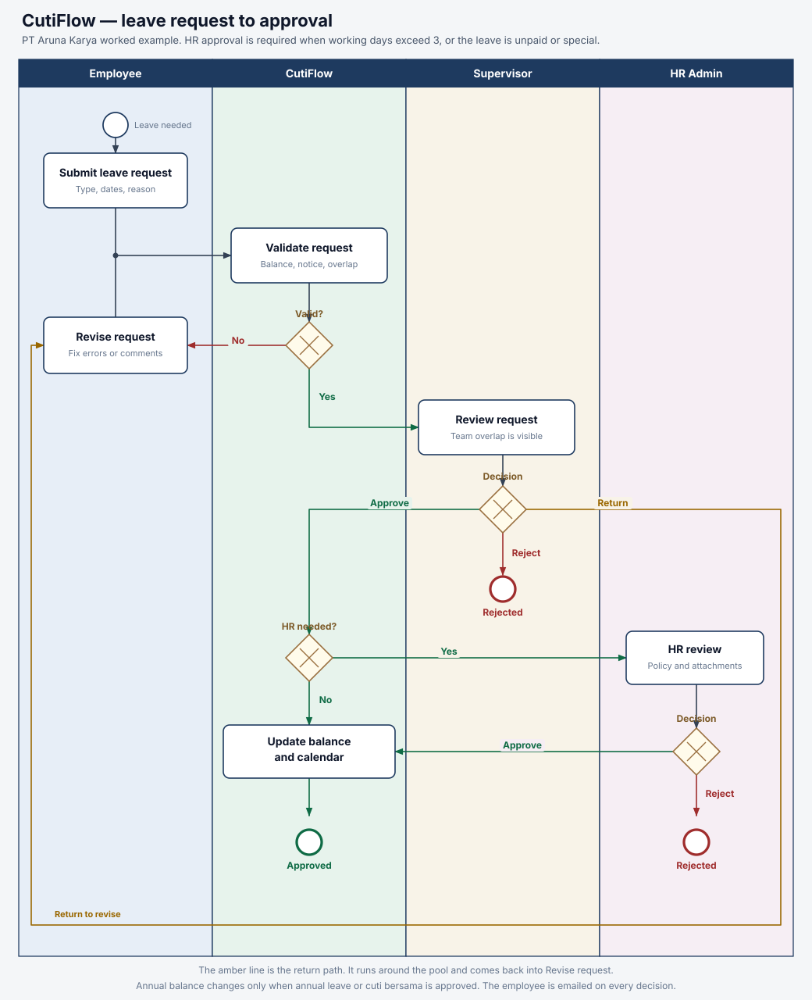

# BA Toolkit

Templates, one worked example, and the diagrams that go with them. Written for IT business analysts who need a requirements set a sponsor can sign and a team can build, not a folder of empty headings.

The example is **CutiFlow**, a leave-request pilot for a fictional Indonesian company. The primary language is English. A few notes are in Bahasa Indonesia where a translation would hide a distinction (`cuti`, `izin`, cuti bersama).

**Author:** [Enrique Muhammad Ilham](https://github.com/EnriqueMuhammad)

## Contents

- [Start here](#start-here)
- [What each template is for](#what-each-template-is-for)
- [Worked example](#worked-example)
- [Diagrams](#diagrams)
- [Guides](#guides)
- [Identifiers](#identifiers)
- [Use this repository](#use-this-repository)
- [Conventions](#conventions)
- [License](#license)

## Start here

If you are about to run a workshop, read the [gathering guide](guides/requirement-gathering.md) and copy the [interview guide](templates/interview-guide.md).

If you want to see the templates filled in before you trust them, open the [CutiFlow example](examples/cutiflow/README.md) and follow its reading order. The chain is interview, workshop, gaps, business requirements, one change request, stories, use cases, functional specification, diagrams, UAT, and a traceability matrix. The IDs meet.

If you only need a file, copy that file. You do not have to adopt the whole set. A small change often needs a [change request](templates/change-request.md), two [stories](templates/user-story.md), and a handful of rows in the [test-case sheet](templates/uat-test-cases.csv).

## What each template is for

| Template | What it is for | What it is not |
| --- | --- | --- |
| [Interview guide](templates/interview-guide.md) | A 30–60 minute script for the person who does the work | The notes of the meeting |
| [Meeting notes](templates/meeting-notes.md) | Decisions, open questions, and actions, sent the same day | A requirements document |
| [Gap analysis](templates/gap-analysis.md) | Current state, target state, and the difference, each with evidence | A solution design |
| [Business requirements](templates/brd.md) | The sponsor's baseline: problem, measures, scope, rules | Screens, fields, and APIs |
| [Change request](templates/change-request.md) | A decision to change something already baselined, including the option to do nothing | A quiet edit to the BRD |
| [User story](templates/user-story.md) | One outcome, with Gherkin a tester can set up | A use case in disguise |
| [Use case](templates/use-case.md) | A flow with more than one actor or more than one ending | A story you were too busy to write criteria for |
| [Functional specification](templates/functional-specification.md) | Statuses, permissions, calculations, data, notifications | A second copy of the business case |
| [UAT test plan](templates/uat-test-plan.md) | Why the business is testing, and when they may stop | A list of clicks |
| [UAT test cases](templates/uat-test-cases.csv) | The clicks, the data, and the expected result | A unit-test export |
| [Traceability matrix](templates/requirements-traceability-matrix.csv) | The proof that every in-scope requirement has a story and a test | A status report |

More on when to skip a file: [templates/README.md](templates/README.md).

## Worked example

[PT Aruna Karya](examples/cutiflow/README.md) is a 95-person firm in Surabaya. Leave is a WhatsApp message plus a Friday spreadsheet. CutiFlow is the pilot that replaces that for one department, with the rules written down far enough that two analysts would count the same working days.

The example is fiction. It is not a reading of Indonesian labour law. Entitlement numbers are labelled as workshop policy that counsel has not reviewed, which is the situation most of these projects are actually in.

| You want | Open |
| --- | --- |
| The rules | [Business requirements](examples/cutiflow/04-brd.md) |
| What changed after baseline | [CR-001 half-day leave](examples/cutiflow/05-change-request-cr-001.md) |
| Something you can lift into a backlog | [User stories](examples/cutiflow/06-user-stories.md) |
| The build contract | [Functional specification](examples/cutiflow/08-functional-specification.md) |
| The test sheet | [UAT cases](examples/cutiflow/uat-test-cases.csv) and the [traceability matrix](examples/cutiflow/requirements-traceability-matrix.csv) |

## Diagrams

Employee submits, the system validates, the supervisor decides, and HR decides only when the request is long, unpaid, or special. The full set, including BPMN, draw.io, and Mermaid, is on the [diagrams page](diagrams/README.md).

## Guides

| Guide | Read it before you |
| --- | --- |
| [Requirement gathering](guides/requirement-gathering.md) | Book a workshop or an interview |
| [Acceptance criteria](guides/acceptance-criteria.md) | Write Given/When/Then that a stranger can fail |
| [BPMN cheat sheet](guides/bpmn-cheat-sheet.md) | Open the `.bpmn` file, or draw your own |
| [MoSCoW](guides/moscow-prioritisation.md) | Let a room call everything Must |

## Identifiers

One scheme, used by the templates and the example.

| Prefix | Stands for |
| --- | --- |
| `BRQ-` | Business requirement, an outcome |
| `BR-` | Business rule |
| `FR-` | Functional requirement |
| `NFR-` | Non-functional requirement |
| `US-` | User story |
| `UC-` | Use case |
| `TC-` | UAT test case |
| `CR-` | Change request |
| `GAP-` | Gap |
| `SH-` | Stakeholder |

MoSCoW values are `Must`, `Should`, `Could`, and `Won't`. `Won't` means not this release, and it stays on the page.

## Use this repository

**Copy a file.** Take the template, delete the guidance blockquotes, and keep the identifier scheme.

**Use it as a GitHub template.** On GitHub, open Settings, then General, and check Template repository. After that, the green **Use this template** button creates a new repository with this history as the start. The steps are the ones in GitHub's documentation on [creating a template repository](https://docs.github.com/en/repositories/creating-and-managing-repositories/creating-a-template-repository).

Someone cloning or generating from the template still needs to delete the CutiFlow example if they do not want a fictional leave system in their project. Keeping it for a week as a reference is reasonable. Shipping it to a client as if it were their discovery is not.

## Conventions

- Dates are ISO (`2026-11-18`) in tables and prose dates are written in full when a rule depends on them.
- Timestamps in the example are Asia/Jakarta.
- Requirements are sentences a sponsor can call true or false. "Support" and "manage" are not requirements until the next sentence says what the person can do.
- A rule that came from a workshop is labelled as such when nobody has matched it to a written policy.
- CSV headers are part of the template. Add columns at the end if you must. Do not rename the existing ones inside a project that has already started.

## Contributing

Corrections that would stop another analyst copying a mistake are welcome. A second fictional case is not. See [CONTRIBUTING.md](CONTRIBUTING.md).

## License

[MIT](LICENSE). Copyright © 2026 Enrique Muhammad Ilham.

The license is there so a team can reuse the templates in their own work, including client projects.
