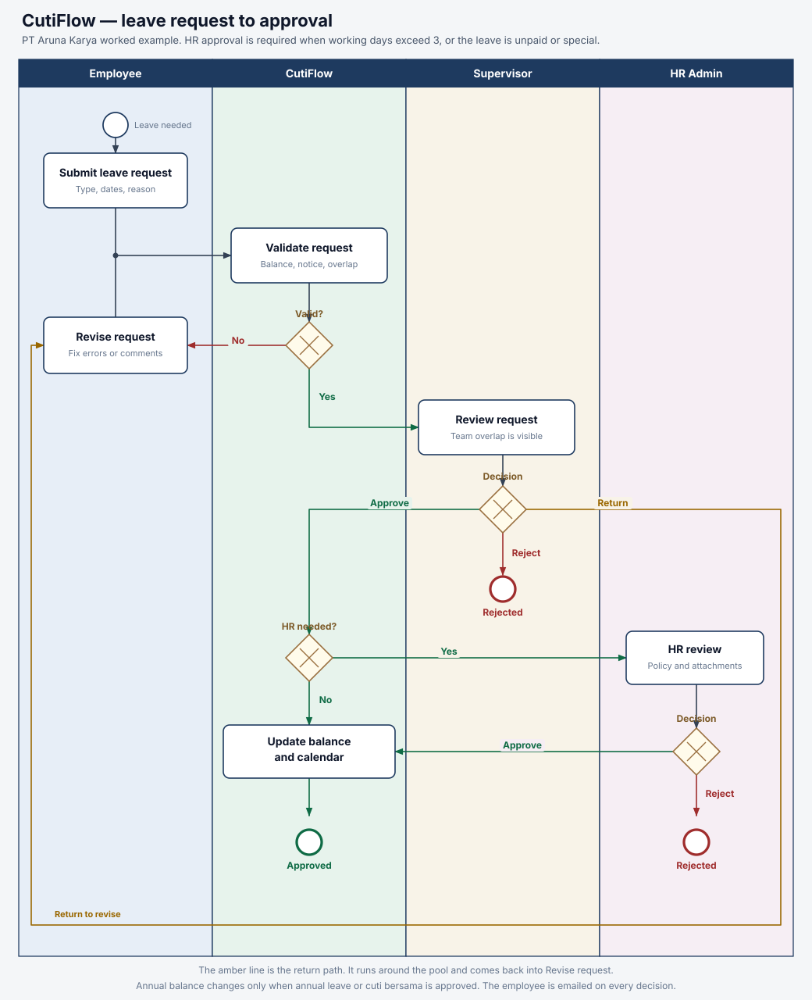
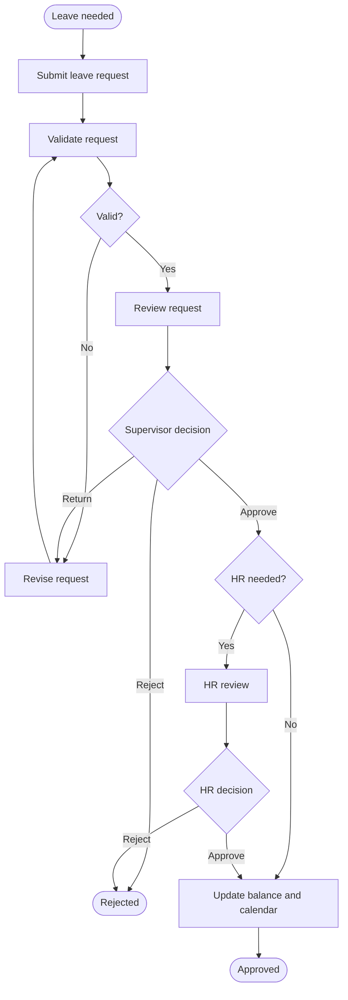
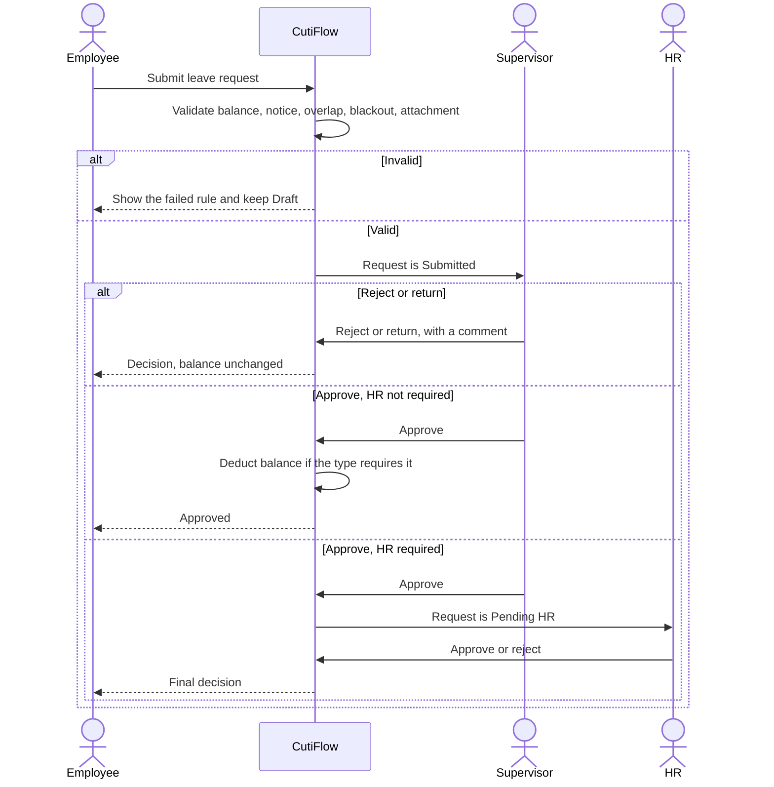
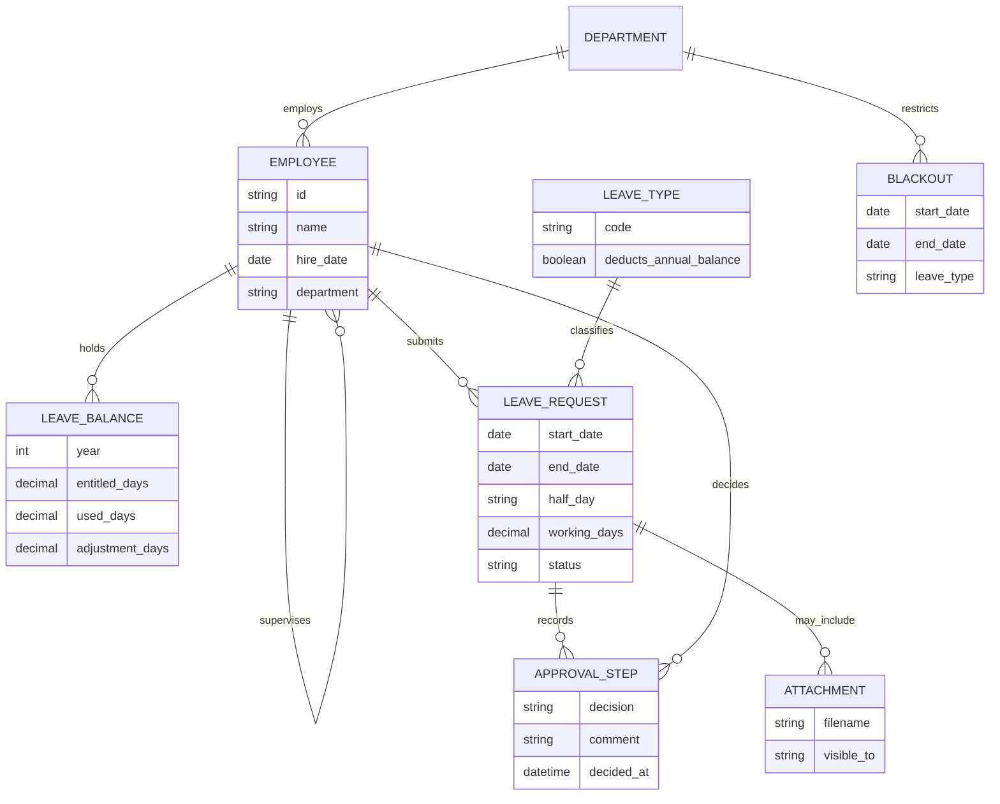

# Diagrams — CutiFlow leave approval

Three views of one process. The decisions are the same. The layout is not, because a README, a modelling tool, and a Markdown file do not want the same canvas.

| File | Open it with | Layout |
| --- | --- | --- |
| [cutiflow-leave-approval.png](cutiflow-leave-approval.png) | Any browser. This is the preview below. | Columns, so the picture stays readable on a page |
| [cutiflow-leave-approval.svg](cutiflow-leave-approval.svg) | A browser or a vector editor | Same drawing as the PNG |
| [cutiflow-leave-approval.drawio](cutiflow-leave-approval.drawio) | [diagrams.net](https://app.diagrams.net/) or the Draw.io VS Code integration | Same column layout as the poster, editable |
| [cutiflow-leave-approval.bpmn](cutiflow-leave-approval.bpmn) | [bpmn.io](https://bpmn.io/) or [Camunda Modeler](https://camunda.com/download/modeler/) | Left to right, which is the easier editing direction |

The `.bpmn` file is a documentation model. `isExecutable` is false. The gateway labels are the business choices. They are not engine expressions to deploy.

Rules the pictures assume, in full in the [BRD](../examples/cutiflow/04-brd.md):

- **Valid?** fails when the notice period, the balance, the overlap, the blackout, or the sick-leave attachment rule fails. The request goes back to the employee.
- **Return** is the supervisor sending it back for changes. The amber line on the poster runs around the edge of the pool and re-enters **Revise request**, then validation runs again.
- **HR needed?** is yes when working days are greater than 3, or the type is unpaid or special ([BR-06](../examples/cutiflow/04-brd.md)).
- **Approved** updates the annual balance only for annual leave and cuti bersama. The employee is told on every decision. Those two facts are captions, not extra tasks, because every outcome would otherwise repeat the same box.

## Poster

## Flowchart

## Sequence

The employee is notified on every final decision. That return message is one arrow here so the chart stays readable. The functional specification lists the emails.

## Data

Holidays are reference data used by the day-count. They are not a child of a request, so they are not drawn as a relationship. A request stores the working-day result, not a copy of the calendar.

Field meanings and the remaining-balance formula are in the [functional specification](../examples/cutiflow/08-functional-specification.md). The [BPMN cheat sheet](../guides/bpmn-cheat-sheet.md) explains the symbols and why this diagram refuses a parallel gateway.
