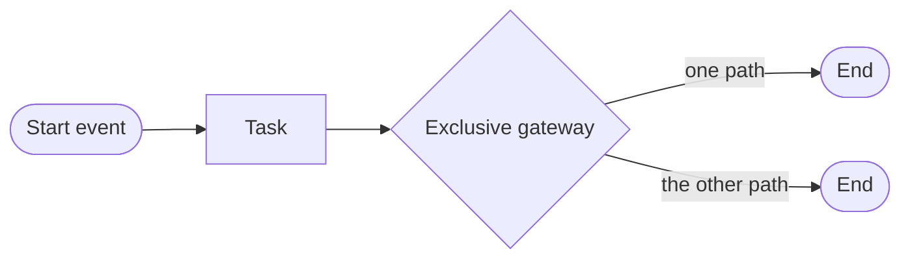

# BPMN cheat sheet

Enough BPMN 2.0 to read and draw the kind of diagram in this repository. It is not the whole specification. The object-management source is the [BPMN 2.0 specification](https://www.omg.org/spec/BPMN/2.0/) if you need a symbol this page does not use.

The CutiFlow process is drawn three ways, on purpose, so you can see the same decisions in different tools:

- [Poster (SVG)](../diagrams/cutiflow-leave-approval.svg) and [PNG](../diagrams/cutiflow-leave-approval.png), also the [draw.io file](../diagrams/cutiflow-leave-approval.drawio)
- [BPMN file](../diagrams/cutiflow-leave-approval.bpmn) for [bpmn.io](https://bpmn.io/) and Camunda Modeler
- [Mermaid](../diagrams/README.md) for the GitHub preview

## The symbols this toolkit actually uses

| Symbol | Draw it when | CutiFlow example |
| --- | --- | --- |
| Start event | A process instance begins. Name the trigger, not the word "start". | Leave needed |
| End event | This path is finished. Two end events may share a name if the outcome is the same and you need them in different lanes. | Approved, and two Rejected ends |
| Task | A person or the system does work that has a start and a finish. | Submit leave request, HR review |
| User task | A person does it. In the `.bpmn` file these are user tasks. | Review request |
| Service task | The system does it with no one waiting at a screen. | Validate request, Update balance and calendar |
| Exclusive gateway | Exactly one outgoing path is taken. Label the decision on the diamond and the choices on the flows. | Valid?, HR needed?, the two Decision diamonds |
| Sequence flow | The order of work inside one pool. | Every arrow in the example |
| Association | A note is attached to a shape and is not a step. | The HR-rule note in the `.bpmn` file |
| Pool | The process boundary. One process, one pool, for a diagram at this level. | CutiFlow — leave approval |
| Lane | Who does the work inside the pool. Lanes are responsibilities, not departments you forgot. | Employee, CutiFlow, Supervisor, HR Admin |
| Text annotation | A rule the picture cannot carry without a paragraph on the arrow. | When HR approval is required |

## Gateways, in one paragraph each

**Exclusive (XOR).** One path. Use this whenever the English word is "or" and they cannot both happen. CutiFlow uses only this gateway. If you cannot label every outgoing flow so that a stranger would pick the same one, you do not understand the decision yet.

**Parallel (AND).** All paths. Use it when two people must both act and neither waits on the other to start, and you have a joining gateway later. Do not use it for "sometimes finance is involved".

**Inclusive (OR).** One or more paths. It looks convenient and it is the usual source of diagrams nobody can execute. Prefer an exclusive gateway with an explicit combined case ("HR, because the request is long or unpaid") unless the business truly combines independent checks.

## Events worth knowing, even if the example stays simple

| Event | Use |
| --- | --- |
| Timer | A deadline: "if the supervisor has not decided in two working days". Put it on the diagram only if the process does something when the time passes. A slogan in a BRD is not a timer. |
| Message | Work arrives from outside the pool, or you throw work to another pool. |
| Terminate end | Everything in the instance stops, including work in other lanes. A normal end only ends that path. The example uses normal ends. |

## What to leave off the diagram

- Screens, field names, and email wording. Those belong in the functional specification.
- Data stores. BPMN has a data object. Most BA diagrams get clearer if the data rule stays in the specification and the diagram stays on sequence.
- A task for every email. "The employee is told" is a side effect of the end, unless someone must do something when the mail arrives. The poster says this in the caption rather than adding a task that every path would duplicate.

## Drawing rules that keep a review short

- The happy path reads in one direction. Exceptions loop back or leave downward. They do not weave through the happy path.
- A gateway has a question name. Flows have short answers: Yes, No, Approve, Reject, Return.
- A task is verb plus object. "Leave" is not a task. "Submit leave request" is.
- If two lanes never do anything, you have the wrong lanes.
- Do not draw a flow into a gateway "to merge" and also decide on that same diamond unless you can explain both jobs. In the example, failed validation and a returned request both go to **Revise request**, and that task flows back to **Validate request**. The diamonds only decide.

## How to open the file in this repository

1. [bpmn.io](https://bpmn.io/) → open `diagrams/cutiflow-leave-approval.bpmn`, or use Camunda Modeler via the [modeler download](https://camunda.com/download/modeler/).
2. The process is marked not executable. That is deliberate. It is a requirements model. Do not deploy it as an engine process without a developer adding real expressions and workers.
3. The poster is arranged in columns so it fits a README. The `.bpmn` file is a left-to-right pool, which is easier to edit. The activities and the decisions are the same. The [diagrams page](../diagrams/README.md) lists the mapping.

## A review checklist

- [ ] Every exclusive flow has a label a tester could turn into data.
- [ ] Every path reaches an end, including reject and return.
- [ ] The return path says where the request re-enters. In CutiFlow it re-enters at revise, then validation runs again.
- [ ] Lane names match the actors in the use cases.
- [ ] You can point from each gateway to a business rule ID. For the HR diamond that ID is `BR-06`.
